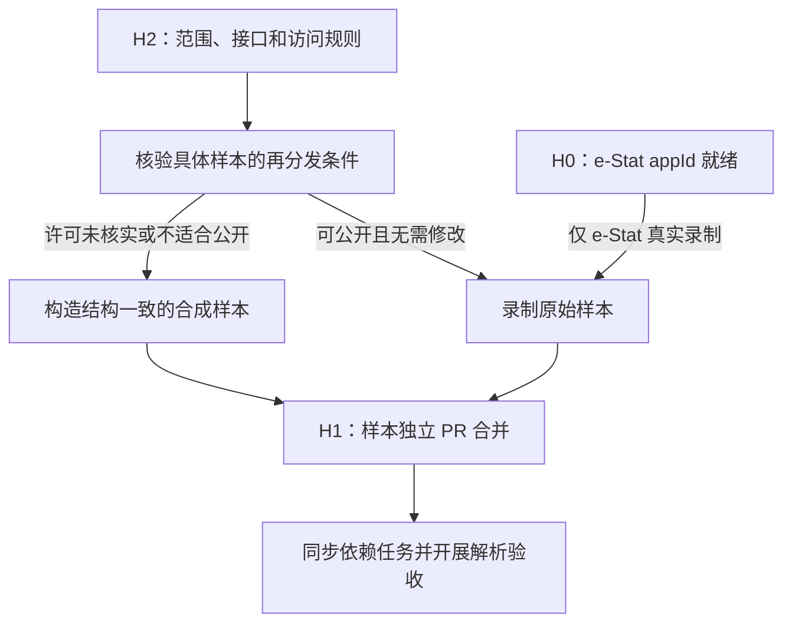

# 数据来源接入决策与样本交付计划（H2 / H1）

- **版本：**v3（2026-10-26）：H1 样本录制后更新（见 0.1 第 9–13 项和第 0.4 节）。v2 同日；v1 未入库。
- **v1 官方资料核对日期：**2026-10-26（沿用 v1 分析中的核查结果）。
- **v2 核对：**分两类记录，见第 0 节。
  - 工程核对：对照仓库代码和 0.4 计划。
  - 外部复核：2026-10-26 实际访问官方页面和 API。
- **适用范围：**13 个来源、13 套独立样本、9 个下游任务，外加 1 个新增开发任务（MAPLE-118，weekly 调度）。
- **文档用途：**为编写 `sources/<id>.yaml`、准备 `tests/fixtures/<来源>/` 和安排任务依赖提供依据。
- **状态说明：**
  - 每个具体值都标了来源：已核实、项目选定、待核实。
  - 项目选定值仍需项目负责人确认后才写入 yaml。
  - 样本录制、提交和合并以实际交付为准。

> 核心建议：统计三源并行推进。WDI 优先走完整条链；Eurostat 以 `daily` 尽早开始积累快照；Federal Register 同时推进。每个来源独立完成 H2 和 H1，不因共享适配器而合并许可判断。data.europa.eu 改走 repo 接口，GovData 元数据许可尽早查清。

## 目录

0. [v2 修订记录与核对边界](#0-v2-修订记录与核对边界)
1. [总览与决策原则](#1-总览与决策原则)
2. [通用规则](#2-通用规则)
3. [H2：按来源的首版范围与具体值](#3-h2按来源的首版范围与具体值)
4. [许可与署名处理](#4-许可与署名处理)
5. [H1：样本交付与验收](#5-h1样本交付与验收)
6. [频率、容量、主机与 robots](#6-频率容量主机与-robots)
7. [依赖关系与推进顺序](#7-依赖关系与推进顺序)
8. [待决策与待核实清单](#8-待决策与待核实清单)
9. [官方资料索引](#9-官方资料索引)

## 0. v2 修订记录与核对边界

### 0.1 本版修正

| # | 修正 | 位置 |
| --- | --- | --- |
| 1 | Eurostat 新增 `gov_10dd_edpt1`（希腊，2000–2015），各数据集分别记录过滤条件；区分“历史年份的当前值”和“历史发布版本” | 3.1 |
| 2 | WDI 年份扩到 2000–2024，新增 `NY.GDP.MKTP.CN`，单独核查元数据和许可 | 3.1、4.3 |
| 3 | 调度频率区分“当前可用配置”和“计划的周频策略”；新增 MAPLE-118 | 6.1、7.2 |
| 4 | 容量和请求率按 `SourceSpec` 现有字段落地；没有字段的限制移到开发任务，并注明实现前不生效 | 6.2 |
| 5 | 仓库已加 `.gitattributes`（`tests/fixtures/** -text`），作为“保留原始字节”的配套措施 | 5.3 |
| 6 | 补齐 H2 具体值：e-Stat 表 ID、经济普查表号、NDB 文件、KSJ 县、ABR 市町村、欧洲门户 ID、Federal Register 起点 | 3、8.1 |
| 7 | Federal Register 分页上限改为实测值（10,000 条 / 50 页，越界页静默返回第 1 页） | 3.2 |
| 8 | data.europa.eu 改走 repo 接口：search 接口的查询 URL 命中 robots `Disallow` | 3.4、6.4 |
| 9 | （v3）9 个来源的 H1 样本已录制，提交为 PR #32（目标 `feature/0.3`） | 5.1 |
| 10 | （v3）**英国、荷兰、德国的 CKAN API 路径被 robots.txt 禁止**，401 按现方案无法实施；列为待决定 | 0.4、3.4、6.4 |
| 11 | （v3）经济普查首版从表 5 改为表 1-1：表 5 有 7,928,961 字节，超过样本预算 | 3.3 |
| 12 | （v3）KSJ 编码已确认：ZIP 内 cp932 和 UTF-8 混合 | 3.3 |
| 13 | （v3）MAPLE-118 已合并，`weekly` 可用；6.1 的周频策略改为当前配置 | 6.1 |

### 0.2 工程核对（对照仓库代码与 0.4 计划）

- **调度频率：**`core/schedule.py` 的 `next_due` 和 `core/monitor.py` 的 `_SCHEDULE_INTERVALS` 只有 `hourly`、`daily`、`monthly`。
  - 写 `weekly` 时，`next_due` 会抛出“不支持的调度”，调度直接出错。
  - 监控也不会为它判断缺口。
- **容量字段：**`SourceSpec` 只有 `rate_per_sec`、`max_total_bytes`、`max_files` 三个相关字段。
  - **v1 和本轮反馈说它们是累计上限，与代码不符。**`core/runner.py` 的 `run_plan` 每次运行把计数清零，所以实际是“每次运行内累计”的上限。
  - 跨运行的累计上限目前没有实现。
  - 单个文件上限默认等于 `max_total_bytes`（`core/http.py` 的 `from_spec`）。
- **robots：**抓取器（`PoliteHttpFetcher`）会检查 robots.txt，命中 `Disallow` 时返回 `blocked_by_robots`，不发请求。
- **0.4 案例需要：**
  - 希腊赤字案例：`gov_10dd_edpt1`，EL，2000–2015，历次发布。
  - 三个 GDP 案例：WDI 美元 GDP 和本币 GDP，JPN、USA、DEU、FRA、GBR，2000–2024。
  - 依据：`docs/plans/0.4-wisteria-samples/*.yaml`。
- **样本字节：**仓库原来没有 `.gitattributes`，本轮已加（提交 2bb7273）。已有样本重新规范化后没有字节变化。

### 0.3 外部复核（2026-10-26 实际访问）

逐项结果写在第 3、4 节对应位置，标为“已核实（2026-10-26）”。主要包括：
- Eurostat 三个数据集的 DSD 和查询 key；
- `format=JSON` 返回 JSON-stat；
- 再利用政策；
- WDI `NY.GDP.MKTP.CN` 的元数据；
- Federal Register API 的分页行为；
- e-Stat 三张表和经济普查表 5；
- KSJ P05 各县文件大小；
- ABR 青ヶ島村文件；
- NDB 第 11 回文件；
- 五个欧洲门户的机构 ID 和 data.europa.eu 的 robots。

**仍未复核：**
- Federal Register 文档页原文：被反爬验证页挡住，结论来自 API 实测；
- 除 data.europa.eu 外，各来源 API 和下载主机的 robots；
- 统计局（stat.go.jp）利用政策页；
- KSJ 文件编码；
- 各样本文件的内容。

### 0.4 阻塞项与决定（2026-10-26 项目负责人已决定）

**决定：**
- 英国、荷兰、德国 CKAN 门户：选 (a)，**0.3 不做，401 移出本版本**。这三个来源不录样本、不写 yaml；以后获得运营方书面许可或找到 robots 允许的官方批量导出再另排。`docs/plans/0.3-maple.md` 已同步修改。
- e-Stat appId：选 (a)，**等 NAS 到货做 H0 时一起放入**；301 和 e-Stat 样本在 H0 之后做。

以下是决定前的原始说明，保留备查。

1. **英国、荷兰、德国 CKAN 的 API 被 robots.txt 禁止**（2026-10-26 读取原文）：
   - 英国 `ckan.publishing.service.gov.uk`：`Disallow: /api/`，另有 `Crawl-Delay: 10`；`data.gov.uk/robots.txt` 当时返回的是故障页（HTML），而 `data.gov.uk/api/` 会跳转到上面这个主机。
   - 荷兰 `data.overheid.nl`：`User-agent: *` 组有 `Disallow: /data/`，API 在 `/data/api/3/action/` 下。
   - 德国 `ckan.govdata.de` 和 `www.govdata.de`：`User-agent: *` 组都是 `Disallow: /`。
   - 抓取器遵守 robots，这三个来源按现方案拿不到任何数据，401 无法实施。
   - 可选：
     - (a) 0.3 先不做这三个门户，401 移出本版本；
     - (b) 向门户运营方申请许可（获得书面许可后另行记录依据）；
     - (c) 另找 robots 允许的官方批量导出（如目录转储），需要逐个核实。
   - 在决定前，这三个来源不录样本、不写 yaml。
2. **e-Stat API 缺 appId（H0）**：样本录制和维度代码确认（getMetaInfo）都要等 appId 放进运行环境。可选：
   - (a) 等 NAS 到货做 H0 时一起做；
   - (b) 先在本机 `.env` 放 appId，录制样本后再迁到 NAS。
   - 301 在此之前不能起草。

## 1. 总览与决策原则

### 1.1 交付单位

| 层次 | 交付物 | 完成条件 |
| --- | --- | --- |
| H2 来源决策 | 每个来源一份接入约定，最终写入 `sources/<id>.yaml` | 许可、访问规则、接口、范围、频率和上限都有明确值或明确限制 |
| H1 样本 | 每个来源一个独立 fixture 目录及 README | 样本可公开、可追溯、类型清楚、能验证关键结构，且独立 PR 已合并 |
| 下游任务 | 采集、解析及整合实现 | 已同步合并后的样本；满足该来源额外的凭据和在线验证条件 |

英国、德国、荷兰是三个独立来源，共享 CKAN 适配器，各自有 source ID、许可判断、配置和 fixture 目录。source ID 沿用计划里的 `uk-data-gov`、`de-govdata`、`nl-data-overheid`。

### 1.2 当前主要风险

1. **维度代码还要用接口确认。**e-Stat 的分类代码要等 H0 的 appId 到位后用 `getMetaInfo` 确认。
2. **许可适用对象容易混淆。**门户元数据许可和外链资源许可要分开；来源默认许可可能有数据集例外。ABR 的条目元数据写 CC BY 4.0，v1 写的是 PDL1.0，两者要一起核对。
3. **原始字节与脱敏、截短冲突。**按 2.2 节的样本类型处理。
4. **历史发布版本无法回补。**Eurostat 和 WDI 的 API 只给当前版本，越晚开始定期抓取，缺的历史版本越多。
5. **共享任务造成整体阻塞。**304、305、401 按来源设子验收项。

### 1.3 标识

- **已核实：**有官方资料或实测支持，且只在相应范围内成立。附核对日期。
- **项目选定：**精选名单、国家与年份、调度频率、请求率、容量和起点日期。需要项目负责人确认。
- **待核实：**还缺接口确认或外部核查的值。

## 2. 通用规则

### 2.1 许可判断落实到具体样本

保留“未核实一律 `internal_only`”的规则，分三层记录：

| 层次 | 要回答的问题 |
| --- | --- |
| 来源默认规则 | 这个来源通常适用什么许可、服务条款和访问规则？ |
| 数据集／指标例外 | 选中的表、指标、年份、地域是否有特别限制？ |
| 具体样本文件 | 这份 JSON、XML、CSV、Excel 或 ZIP 能否进入公开仓库？ |

目录门户还要分别记录两种许可：
- **元数据许可：**标题、描述、组织、资源链接等目录内容的许可。
- **资源许可：**目录指向的 CSV、Excel、地图等文件的许可。

CKAN 响应里的 `license_id` 描述的是被收录的数据集，不能当作这份 JSON 响应自身的许可依据。

`internal_only` 是分发策略，不代表允许抓取。能否抓取和能否再分发要分别核实。

### 2.2 样本类型

| 类型 | 定义 | README 必须说明 |
| --- | --- | --- |
| `captured` | 响应体或下载文件原样保存 | URL、抓取时间、字节数、SHA-256 |
| `sanitized` | 对真实内容做过脱敏 | 修改字段和脱敏规则 |
| `derived` | 截短、抽取、转换等派生内容（包括从 ZIP 里取出的单个文件） | 原文件来源、处理方法、保留范围 |
| `synthetic` | 按已核实结构构造 | 结构依据、生成时间、虚构内容范围 |

“保持原始字节”只适用于 `captured`。优先选本来就小、可公开、不用脱敏的原始文件：
- API 用服务端过滤缩小响应；
- Excel 优先找小表；
- ZIP 保留完整原始包；
- 合成样本只复现结构和必要特征，不复制未获再分发许可的真实内容。

### 2.3 分离目录范围与数据范围

- e-Stat 可以只抓若干调查的目录，只下载精选表的观测值。
- 欧洲门户可以保存资源格式、下载地址等元数据，同时设 `download_resources: false`。
- 欧洲五门户首版统一为：**采集数据集及资源描述，不跟随资源链接下载文件。**

### 2.4 来源独立验收

共享代码不等于共享许可、范围或样本验收。某个来源没就绪时，其他满足条件的来源可以独立交付。样本必须先单独提交、合并，再同步依赖它的任务。

## 3. H2：按来源的首版范围与具体值

### 3.1 三个统计 API

#### e-Stat `jp-estat-api`

- **入口：**[JSON API 3.0](https://api.e-stat.go.jp/rest/3.0/app/json/)，主机 `api.e-stat.go.jp`。
- **端点：**`getStatsList`、`getMetaInfo`、`getStatsData`。
- **凭据：**appId 由运行环境提供（H0）。不进 README、日志或请求录制；API 规约禁止向第三方转让、出借 appId。

**精选表（已在 e-Stat 页面核实，2026-10-26）：**

| # | statsDataId | 表标题 | 调查（政府統計コード） | 过滤条件（项目选定） |
| --- | --- | --- | --- | --- |
| 1 | `0003443838` | 年齢（５歳階級），男女，月別人口－総人口（各月１日現在）-令和２年国勢調査基準- | 人口推計 各月1日現在人口 概算値（00200524） | 男女計；年龄「総数」；全国；最近 24 个月 |
| 2 | `0003005865` | 労働力人口比率，就業率及び完全失業率（2000年1月～） | 労働力調査 基本集計（00200531） | 男女計；全国；2000 年 1 月起 |
| 3 | `0003427113` | 消費者物価指数（2020年基準） | 消費者物価指数（政府統計コード待核实，一般为 00200573） | 表章「指数」；品目 `0001 総合`；地域全国；只取月次 |

- **表页面：**`https://www.e-stat.go.jp/dbview?sid=<statsDataId>`。
- **选择理由：**人口、就业、物价三类覆盖跨国比较的基础指标；三张表都在持续更新（2026-10 内有更新）；只取全国，体积小。
- **待核实：**
  - 维度代码（`cdCat01`、`cdArea` 等）页面上不显示，要用 `getMetaInfo` 确认，依赖 H0。
  - 表 1 的 sid 每月是否沿用，要连续观察。
  - 表 2 是原数值还是季调值，页面没写清楚。
  - 表 3 的全国地域代码是否为 `00000`。
- **目录范围：**只覆盖上述三个调查的统计表目录。

依据：[API 3.0 规格][estat-api]、[API 利用规约][estat-api-terms]。

#### Eurostat `eu-eurostat`

- **入口：**[SDMX 2.1 API](https://ec.europa.eu/eurostat/api/dissemination/sdmx/2.1/)，主机 `ec.europa.eu`。
- **格式：**默认返回 SDMX-ML 2.1 Generic（实测 `application/vnd.sdmx.genericdata+xml;version=2.1`）。`format=JSON` 返回的是 JSON-stat 2.0，不是 SDMX-JSON（已核实，2026-10-26）。首版统一用 SDMX-ML 2.1。
- **结构：**直接查 `/datastructure/ESTAT/<ID>`。实测带 `?references=datastructure` 查 dataflow 会返回 400（错误码 140）。

**各数据集分别记录过滤范围（不互相套用）：**

| 数据集 | 维度顺序 | 查询 key | 时间 | 内容 | 状态 |
| --- | --- | --- | --- | --- | --- |
| `nama_10_gdp` | freq, unit, na_item, geo | `A.CP_MEUR.B1GQ.DE+FR+NL` | 2020–2024 | 市场价格 GDP，现价，百万欧元 | 已核实（2026-10-26） |
| `demo_pjan` | freq, unit, age, sex, geo | `A.NR.TOTAL.T.DE+FR+NL` | 2020–2024 | 1 月 1 日人口，全年龄，男女合计 | 已核实（2026-10-26） |
| `gov_10dd_edpt1`（新增） | freq, unit, sector, na_item, geo | 见下 | 2000–2015 | 希腊一般政府赤字和债务 | 已核实（2026-10-26） |

`gov_10dd_edpt1` 的三条序列（地区 `EL`，sector `S13` = General government）：

| 内容 | key | 单位 |
| --- | --- | --- |
| 赤字率（净借贷，赤字为负） | `A.PC_GDP.S13.B9.EL` | 占 GDP 百分比 |
| 赤字额 | `A.MIO_EUR.S13.B9.EL` | 百万欧元 |
| 债务额（一般政府合并总债务，马斯特里赫特口径） | `A.MIO_EUR.S13.GD.EL` | 百万欧元 |

- **合并查询：**`A.PC_GDP+MIO_EUR.S13.B9+GD.EL?startPeriod=2000&endPeriod=2015`（实测可用）。这个组合会多取 `PC_GDP.GD`（债务率），可以保留。
- **示例 URL：**`https://ec.europa.eu/eurostat/api/dissemination/sdmx/2.1/data/gov_10dd_edpt1/A.PC_GDP.S13.B9.EL?startPeriod=2000&endPeriod=2015`。实测返回 16 个值（2009 年为 -15.4）。
- **选择理由：**0.4 的希腊赤字案例（`greece-deficit-revision-chain.yaml`）需要这三项。

**历史年份的当前值 vs 历史发布版本：**
- **历史年份的当前值：**现在查到的 2000–2015 年数据，是最新一次发布的值。
- **历史发布版本：**同一观测值在不同发布日期的值（如希腊 2009 年赤字率在历次通报中的修订）。
- Eurostat API 只提供当前版本。我们的定期快照只能积累开始采集之后的版本，**不能据此声称已获得过去各次发布时的数值**。过去的版本要另找发布档案（如历次 EDP 通报新闻稿），属于 0.4 的缺口报告范围。
- 因此 Eurostat 要尽早开始定期采集：
  - 首次运行保存基线；
  - 之后每次快照记录抓取时间、来源 URL 和内容哈希；
  - 保留旧版本，不覆盖。
- 当前用 `daily`，不等 weekly（见 6.1）。

**跨源口径：**`demo_pjan` 是 1 月 1 日人口。人口时点、GDP 币种和价格口径都要保留，不能只按指标名合并。

依据：[SDMX 2.1 数据查询格式][eurostat-query]、[人口数据集][eurostat-population]、[GOV_10DD_EDPT1 DSD][eurostat-edpt1-dsd]。

#### WDI `intl-wdi`

- **入口：**[World Bank API v2](https://api.worldbank.org/v2/)，主机 `api.worldbank.org`。明确请求 `format=json` 和 `source=2`（WDI）。
- **国家：**JP、US、GB、DE、FR、NL（ISO3：JPN、USA、GBR、DEU、FRA、NLD）。API 已确认 6 个代码都有效。
  - 0.4 三个 GDP 案例要求的 JPN、USA、DEU、FRA、GBR 全部覆盖。
  - NL 用于和 Eurostat 对照。
  - 排除地区和收入组等聚合项。
- **年份：**2000–2024（原为 2015–2024），覆盖 0.4 案例。

**指标：**

| 指标 | 含义 | 单位 | 许可（指标页） | 状态 |
| --- | --- | --- | --- | --- |
| `SP.POP.TOTL` | 总人口 | 人 | CC BY 4.0 | v1 已核实 |
| `NY.GDP.MKTP.CD` | GDP，现价美元 | 美元 | CC BY 4.0 | v1 已核实 |
| `SP.DYN.LE00.IN` | 出生时预期寿命 | 年 | CC BY 4.0 | v1 已核实 |
| `NY.GDP.MKTP.CN`（新增） | GDP，现价本币（"GDP (current LCU)"） | 本币；API 的 `unit` 字段为空，单位只写在 sourceNote 里（"expressed in local currency units"） | CC BY-4.0（指标页）；API 元数据没有许可字段 | 已核实（2026-10-26） |

- `NY.GDP.MKTP.CN` 的数据提供方原文："Country official statistics, National Statistical Organizations and/or Central Banks; National Accounts data files, OECD; Staff estimates, World Bank"。
- 单位不能从 API 的 `unit` 字段取。解析时要按指标记录单位，本币 GDP 不能和美元 GDP 混在一起。
- WDI 数据源最近更新为 2026-10-08（`/v2/sources/2`）。
- **更新方式：**清单较小，每次重读整个选定区间，覆盖历史修订。
- **分页样本：**缩小国家和年份，设小 `per_page`，保存至少两页完整结果。

依据：[人口][wdi-population]、[GDP 美元][wdi-gdp]、[预期寿命][wdi-life-expectancy]、[GDP 本币][wdi-gdp-lcu]、[本币 GDP API 元数据][wdi-gdp-lcu-api]、[API 调用与分页][wdi-api]。

### 3.2 Federal Register：`us-fedreg`

| 决策项 | 值 | 状态 |
| --- | --- | --- |
| 文书类型 | `conditions[type][]` = `RULE`、`PRORULE`、`NOTICE` | 过滤值已实测（2026-10-26）；无效值不报错，返回 count=0 |
| 首版排除 | Public Inspection；`PRESDOCU`（Presidential Document） | 项目选定 |
| 增量起点 | **2026-10-01**（`conditions[publication_date][gte]=2026-10-01`） | 已确认（2026-10-26） |
| 历史回补 | 不做全历史；以后另设回补批次 | 项目选定 |
| 调度 | `daily`，每次重查最近 7 天 | 项目选定 |
| 内容 | 检索 JSON + 结构化全文；保留文书编号、发布日期和官方版本链接 | 项目选定 |

- **入口：**[Federal Register API v1](https://www.federalregister.gov/api/v1/)，主机 `www.federalregister.gov`。全文用 API 返回的官方链接；引入其他主机时另行核实并加入白名单。无需 Key。
- **分页上限（v1 的“2,000 条”与实测不符，已更正）：**
  - `count` 最多显示 10,000，`total_pages` 最多 50；
  - `per_page` 最小有效值是 20，可以填到 2000；
  - **`page` 超过 50 不报错，而是静默返回第 1 页**；
  - 抓取必须按日期切分窗口，每个窗口不超过 10,000 条，并检查 `total_pages`；
  - 返回里还有 `search_after_cursor` 游标。
- **日期过滤：**`conditions[publication_date][is|gte|lte|year]` 都实测可用。
- **未复核：**官方说明页被反爬验证页挡住（302 到 unblock 页，没有绕过），上面的结论都来自 API 实测。
- **起点为什么是 2026-10-01：**
  - 原建议是“首次上线前 30 天”，按 201 预计的上线时间换算并固化。
  - 补抓 10 月以来约一个月的数据，体积小，也能验证增量逻辑。
  - 若 201 上线晚于 2026-11 月底，改日期前再确认。

依据：[API 实测][fedreg-api-docs]、[1 CFR § 2.6][fedreg-reuse]。

### 3.3 日本四个文件来源

#### 国土数值信息 `jp-ksj`

| 项 | 值 | 状态 |
| --- | --- | --- |
| 数据集 | P05 市町村役場等及び公的集会施設，2022 年版 | 已核实（2026-10-26） |
| 县 | **佐賀県（41）** | 项目选定 |
| 文件 | `P05-22_41_GML.zip`，69,725 字节（HEAD 实测），Last-Modified 2023-07-28 | 已核实（2026-10-26） |
| 下载地址 | https://nlftp.mlit.go.jp/ksj/gml/data/P05/P05-22/P05-22_41_GML.zip | 已核实（2026-10-26） |
| 格式 | GML（JPGIS2014 準拠）和シェープファイル；坐标系 JGD2011；点数据 | 已核实（2026-10-26） |
| 许可 | 数据页标注「オープンデータ（CC_BY_4.0）」；只对 P05-2022 成立 | 已核实（2026-10-26） |
| 编码 | ZIP 内文件名都是 ASCII；`KS-META-P05-22_41.xml`、`.dbf` 是 cp932，`.geojson`、GML `.xml` 是 UTF-8；另有 `.shp`/`.shx`/`.prj` | 已核实（2026-10-26，下载检查） |

- **选择理由：**全县中实际体积最小。福井页面上也标 0.07MB，但实测 78,381 字节，比佐賀大。完整 ZIP 可以原样作为 `captured` 样本。
- **暂不做：**回补其他年份。
- **混合编码样本：**是否同时含 SJIS 和 UTF-8 要下载检查；不能改原 ZIP 来凑编码组合，必要时另补合成编码样本并写明用途。

依据：[P05-2022 数据页][ksj-p05]、[KSJ 总规约][ksj-terms]。

#### 2024 经济普查 `jp-census`

| 项 | 值 | 状态 |
| --- | --- | --- |
| 调查 | 令和6年経済センサス‐基礎調査（00200552），**甲調査**（民营事业所），正式集计（确报） | 已核实（2026-10-26） |
| 发布 | 甲调查正式集计 2025-12-24；速报集计（2025-05-30）另放，不混用；乙调查 2025-05-30 | 已核实（2026-10-26） |
| 表（v2 原定，v3 改为表 1-1） | **表番号 5**：産業(大分類)、経営組織(4区分)、単独・本所・支所、従業者規模(9区分)別民営事業所数、従業者数及び常用雇用者数(雇用者のいない個人経営の事業所を除く)－全国、都道府県 | 已核实（2026-10-26） |
| 文件 | Excel，statInfId `000040389329`；下载 https://www.e-stat.go.jp/stat-search/file-download?statInfId=000040389329&fileKind=0 | 已核实：7,928,961 字节，超过样本预算 |
| **首版改用（v3）** | **表 1-1**：全国、都道府県、市区町村别民営事業所数和従業者数（不分产业）；statInfId `000040389320`，sid `0004040098`；文件 `c1_001_1.xlsx`，102,198 字节；下载直接 200，无跳转 | 已核实（2026-10-26）；样本见 PR #32 |
| DB 版 | sid `0004040082`（https://www.e-stat.go.jp/dbview?sid=0004040082） | 已核实（2026-10-26） |
| 条款 | 下载入口在 e-Stat，适用 e-Stat 利用规约（见 4.1） | e-Stat 规约已核实；统计局政策页未复核 |

- **选择理由：**表 5 有产业×都道府县，覆盖事业所数和从业者数，适合做跨地区比较。
- **备选：**更简单的表 1-1（不分产业，到市区町村）：statInfId `000040389320`，sid `0004040098`。
- **口径：**2024 年甲调查排除了没有雇员的个人经营事业所，与部分往年调查的范围不同，配置和 README 都要写明。
- **备注：**该表在 e-Stat 有 DB 版，以后可以改走 e-Stat API。首版按文件来源，保留原始 Excel。

依据：[统计局调查结果页][census-results]、[e-Stat 表 5 文件页][census-table5]。

#### 医疗开放数据 `jp-mhlw`

| 项 | 值 | 状态 |
| --- | --- | --- |
| 数据集 | **采用 NDB オープンデータ** | 已确认（2026-10-26） |
| 发布版 | 第 11 回，2026-06-16 公开 | 已核实（2026-10-26） |
| 观测年度 | 特定健診：令和 5 年度（2023 年度实施分）；レセプト：令和 6 年度 | 已核实（2026-10-26） |
| 抓取文件 | 特定健診 質問票 ZIP：https://www.mhlw.go.jp/content/12400000/001711941.zip ，3,148,349 字节（HEAD 实测） | 已核实（2026-10-26） |
| 使用的表 | ZIP 内「08_特定健診_問診項目/標準的な質問票（質問項目１）　都道府県別性年齢階級別分布.xlsx」，压缩后约 21.5KB；文件名含全角数字和全角空格 | 已核实（2026-10-26，读 ZIP 目录得到，没有下载整包） |
| 许可 | 厚生劳动省网站政策适用 PDL1.0，要求注明出处；NDB 页面没有单独许可 | 已核实（2026-10-26） |

- **选择理由：**都道府县×性别×年龄的分布表结构规整，体积小，适合首版。
- **抓取方式：**只能整包下载 ZIP（约 3MB），再取出单个文件。
- **小格子遮蔽：**
  - 集计单位小于 10 时显示半角连字符 `-`；
  - 某组只有一个值被遮时，为防反推，会把 10 以上的最小值也遮掉；
  - 「0 不遮」的例外只适用于レセプト，不适用于特定健診。
  - 采集层原样保留，不改成零。
  - 依据：解说编第 1-5 节。
- **样本：**ZIP 3MB，在 5 MiB 预算内，可以作为 `captured` 提交；也可以只提交取出的 xlsx，标为 `derived`。

依据：[第11回 NDB][mhlw-ndb]、[NDB 总页][mhlw-ndb-index]、[NDB 解说编][mhlw-ndb-guide]、[厚生劳动省网站政策][mhlw-terms]。

#### ABR `jp-abr`

| 项 | 值 | 状态 |
| --- | --- | --- |
| 数据 | 町字マスター（文字信息），市区町村级 | 已核实（2026-10-26） |
| 市町村 | **東京都青ヶ島村**，全国地方公共団体コード `134023`（取自官方文件名） | 项目选定；代码已核实 |
| 文件 | https://data.address-br.digital.go.jp/mt_town/city/mt_town_city134023.csv.zip ，561 字节（HEAD 实测） | 已核实（2026-10-26） |
| 版本 | 最终更新 2026-03-10T12:05:43Z（条目说明和 Last-Modified 一致）；条目上没有单独版本号 | 已核实（2026-10-26） |
| 数据集页面 | https://dataset.address-br.digital.go.jp/documents/fbd6a731462c4fc7a31af06a5b98192d/about （ArcGIS Hub，要 JS 才显示） | 已核实（2026-10-26） |
| 下载主机 | `data.address-br.digital.go.jp`（AmazonS3）；目录站点是 `dataset.address-br.digital.go.jp` | 已核实（2026-10-26） |
| 许可 | 条目元数据 licenseInfo 为 CC BY 4.0；accessInformation 指向 ABR 使用规约；v1 写的是“默认 PDL1.0” | 两者要一起核对，见 8.2 |

- **选择理由：**全国最小的村之一，完整 ZIP 只有 561 字节，可以原样作为 `captured` 样本。
- **备选：**御蔵島村 `133825`。
- **旧主机：**另有一条旧条目指向 `gov-csv-export-public.s3.ap-northeast-1.amazonaws.com`（2025-11 版），不用；白名单只放 `data.address-br.digital.go.jp`，不泛放 `amazonaws.com`。
- **首版范围：**只取町字文字信息。町字地图、地番、住居表示仍有试验版性质，不纳入。

依据：[ABR 官方介绍][abr-overview]、[下载入口][abr-download]、[ABR 使用规约][abr-terms]。

### 3.4 五个欧洲目录门户

共同首版范围：
- 只采集数据集和资源元数据，`download_resources: false`；
- 排除账号、讨论、评论等；
- 列表和详情通过同一记录 ID 关联。

**选择原则（项目选定）：**每个门户先选该国统计机构，和统计三源的口径一致；数量太大时再加一个中等规模的机构作对照。

| 门户 | 接口与主机 | 过滤 ID（已用 API 确认，2026-10-26） | 示例 |
| --- | --- | --- | --- |
| 英国 `uk-data-gov`（**robots 禁止 `/api/`，见 0.4**） | CKAN；`data.gov.uk/api/action/` 经 2 次跳转到 **`ckan.publishing.service.gov.uk`**，直接用新主机 | `office-for-national-statistics`（5,647 个）；对照 `hm-revenue-and-customs`（137 个） | `https://ckan.publishing.service.gov.uk/api/action/package_search?fq=organization:office-for-national-statistics&rows=1` |
| 德国 `de-govdata`（**robots 全站禁止，见 0.4**） | CKAN；`ckan.govdata.de/api/3/action/`，无跳转 | `statistisches-bundesamt`（3,149 个）；对照 `umweltbundesamt`（222 个） | `https://ckan.govdata.de/api/3/action/package_search?fq=organization:statistisches-bundesamt&rows=1` |
| 荷兰 `nl-data-overheid`（**robots 禁止 `/data/`，见 0.4**） | CKAN；`data.overheid.nl/data/api/3/action/` | `centraal-bureau-voor-de-statistiek`（显示名 CBS OpenData，5,996 个）；对照 `de-nederlandsche-bank`（120 个） | `https://data.overheid.nl/data/api/3/action/package_search?fq=organization:centraal-bureau-voor-de-statistiek&rows=1` |
| 法国 `fr-data-gouv` | udata v1；`www.data.gouv.fr/api/1/` | INSEE：id `534fff81a3a7292c64a77e5c`（190 个） | `https://www.data.gouv.fr/api/1/datasets/?organization=534fff81a3a7292c64a77e5c&page_size=1` |
| `eu-data-europa` | **repo 接口** `data.europa.eu/api/hub/repo/` | catalogue `publ`（Publications Office，387 个） | 列 ID：`https://data.europa.eu/api/hub/repo/catalogues/publ/datasets?valueType=identifiers&limit=100&offset=0`；详情：`/api/hub/repo/datasets/<id>` |

**分页：**
- CKAN：`rows` + `start`；
- udata：`page`（从 1 开始）+ `page_size`；
- data.europa.eu repo：`limit` + `offset`。

各门户的细节：

- **英国：**
  - 站点 OGL v3.0，另有声明者除外；
  - 新的 curated collections 不在 API 里，配置写 API directory；
  - 白名单要包含跳转后的主机；
  - 两个对照机构的显示名按 slug 写，未查。
- **德国：**
  - 只采 CKAN 可见字段，SPARQL 扩展另立范围；
  - 元数据统一再分发依据未闭环，维持 `internal_only`，H1 用合成 CKAN 响应；
  - `bundesamt-fur-bauwesen-und-raumordnung-bbr` 存在但数据集为 0，不用。
- **荷兰：**
  - 门户信息 CC0；
  - 元数据可能用受控词表 URI，解析不能假设许可、主题、组织都是短字符串；
  - `organization_list` 即使给 limit=1000 也只返回 25 条，看全部组织要用 `package_search?rows=0&facet.field=["organization"]`；
  - `rijkswaterstaat`、`kadaster`、`planbureau-voor-de-leefomgeving` 查到 0 个数据集，不用。
- **法国：**
  - 官方目录导出采用 Licence Ouverte 2.0；
  - `organization=` 只接受 24 位十六进制 id，传 slug 会报错；
  - 组织详情可以用 slug：`/api/1/organizations/institut-national-de-la-statistique-et-des-etudes-economiques-insee/`。
- **data.europa.eu：**
  - **改走 repo 接口**：先按 catalogue 列 ID，再逐个取详情（JSON-LD；加 `.ttl` 返回 Turtle）。
  - search 接口 `/api/hub/search/search?...` 命中 robots 的 `Disallow: /*search?*`，抓取器会判为 `blocked_by_robots`；它的排序也不稳定。
  - **为什么选 `publ` 不选 `estat`：**`estat` 有 9,936 个数据集，和 `eu-eurostat` 来源重复；逐个取详情还会超过 `max_files`。
  - 门户元数据 CC0 1.0，资源本体许可独立；SPARQL 留作扩展。

依据：[英国 API 文档][uk-api]、[英国站点条款][uk-terms]、[GovData 元数据目录][govdata-catalog]、[GovData 使用条款][govdata-terms]、[荷兰 API 与许可][nl-api]、[荷兰 API 字段][nl-api-guide]、[法国目录][fr-catalog]、[法国 API 指南][fr-api]、[data.europa.eu API 总览][eu-api]、[法律与许可声明][eu-legal]、[robots][eu-robots]。

## 4. 许可与署名处理

### 4.1 e-Stat

- **许可名称：**记录“政府統計の総合窓口（e-Stat）利用規約”及官方 URL。
- **内容：**允许符合条件的复制、传播、加工和商用，要求出处和加工说明；页面写明「CC BYに従うことでも利用することができます」（CC BY 4.0）。规约 2016-01-29 制定（已复核，2026-10-26）。
- **数据出处写法：**
  > 出典：政府統計の総合窓口(e-Stat)（https://www.e-stat.go.jp/）
  
  实际文件再补调查名称、表标题、提供机关和表 ID。
- **服务信用文本**（使用 API 时另外显示）：
  > このサービスは、政府統計総合窓口(e-Stat)のAPI機能を使用していますが、サービスの内容は国によって保証されたものではありません。
- 数据出处和服务信用文本是两项要求，都要做。

依据：[内容利用规约][estat-terms]、[API 服务信用文本][estat-credit]。

### 4.2 Eurostat

许可依据用 Eurostat 的统计数据再利用政策（已复核，2026-10-26）：
- 统计数据可用于商业和非商业用途，条件是注明来源；编辑内容按 CC BY 4.0，要注明来源并说明修改。
- EU、EFTA、入盟国和候选国以外国家的数据（页面举例美国、日本、中国）不能商业再利用。
- EL、DE、FR、NL 都是 EU 成员国，不受这条限制。这一点按成员国身份推出，页面没有逐个列国家。
- 个别数据或文件可能有特别条件，具体数据集声明要逐个看。

依据：[版权与再利用政策][eurostat-copyright]。

### 4.3 WDI

- **许可：**记录“CC BY 4.0 + World Bank 数据集附加条款”，并保存附加条款 URL。
- **核实范围：**四个选定指标页都标 CC BY 4.0（`NY.GDP.MKTP.CN` 于 2026-10-26 复核）。不推广到全部 WDI；第三方指标可能另有条件。
- **署名：**同时写 World Bank 和已知数据提供方。官方格式：
  > The World Bank: Dataset name: Data source (if known).
- **本币 GDP 的数据提供方：**见 3.1。

依据：[World Bank 数据集条款][wdi-terms]。

### 4.4 Federal Register

- **再分发依据：**1 CFR § 2.6，不要写成 CC0。该条款允许复制和再发布 Federal Register 刊载的材料。
- **记录内容：**文书名称、编号、发布日期和来源链接。
- **限制：**再发布者不得使用 NARA/OFR 官方标志或印章。

依据：[1 CFR § 2.6][fedreg-reuse]。

### 4.5 日本文件来源

| 来源 | 许可依据 | 署名及例外 |
| --- | --- | --- |
| KSJ P05-2022 | 数据页标注 CC BY 4.0（已复核）；总规约默认 PDL1.0 并有例外 | 标明数据名称、年份、国土交通省及来源 URL；加工另说明 |
| 经济普查 | 下载入口在 e-Stat，适用 e-Stat 规约；统计局政策参照 PDL1.0（未复核） | 标明调查、表名、发布机关和来源；保留调查口径 |
| MHLW（NDB） | 网站政策适用 PDL1.0（已复核） | 标明数据名称、厚生劳动省、来源及使用日期；加工另说明 |
| ABR | 条目元数据 CC BY 4.0；v1 记为默认 PDL1.0；地番和位置参照有额外条款 | 标明数据名称、数字厅和来源；首版不纳入地番 |

依据：[KSJ 总规约][ksj-terms]、[P05 数据页][ksj-p05]、[统计局政策][stat-terms]、[MHLW 政策][mhlw-terms]、[ABR 条款][abr-terms]、[PDL1.0][pdl]。

### 4.6 欧洲门户

| 门户 | 处理 |
| --- | --- |
| 英国 | OGL v3.0；优先用提供方指定的署名，没有时用许可证默认文本 |
| 德国 | 全目录元数据的统一开放许可未证明，维持 `internal_only`；不能推导为“禁止再分发” |
| 荷兰 | 门户元数据 CC0；无强制署名，项目仍保留来源记录 |
| 法国 | Licence Ouverte 2.0；保留来源和数据最后更新时间，不能用抓取时间代替 |
| data.europa.eu | 门户元数据 CC0 1.0；资源本体许可独立 |

“没有强制署名要求”和“尚未核实署名要求”要分开表示。

依据：[OGL v3.0][ogl]、[Licence Ouverte 2.0][lo2] 及各门户条款。

## 5. H1：样本交付与验收

### 5.1 最小充分样本

| 来源 | 最小交付（具体文件） | 关键验收点 | 下游任务 |
| --- | --- | --- | --- |
| Federal Register | 2026-10-01 以后的一页检索 JSON + 其中一篇多节文书的全文 | 同一文书编号；节标题与正文层次可验证 | 201 |
| e-Stat | 表 1–3 中一张表的 getStatsList + getMetaInfo + getStatsData | 同一 statsDataId；分类代码能由元数据解释；验收分页时补真实续页 | 301（需 H0） |
| Eurostat | `gov_10dd_edpt1` 合并查询结果 + 其 DSD；`nama_10_gdp` 一个小查询 + DSD | 能解释维度、单位、观测状态；必要 codelist 一并提供 | 302 |
| WDI | `NY.GDP.MKTP.CD` 与 `NY.GDP.MKTP.CN` 的 JSON，小 `per_page`，至少两页 | 真实跨页结果；单位按指标区分 | 303 |
| KSJ | `P05-22_41_GML.zip`（69,725 字节）原样 | 包内文件名、格式、编码和体积有记录；不重打包 | 304 |
| 经济普查 | 表 5 Excel（statInfId 000040389329）原样；超过 5 MiB 时截短并标 `derived` | 表头、脚注、特殊值保留 | 304 |
| NDB | 質問票 ZIP（3,148,349 字节）原样，或取出的質問項目１ xlsx（标 `derived`） | 数据名称、第 11 回、令和 5 年度；`-` 遮蔽原样保留 | 305 |
| ABR | `mt_town_city134023.csv.zip`（561 字节）原样 | 前导零、空值、日文字符、日期列原样 | 305 |
| 英国 | ONS 一页 package_search（`rows` 小）+ 其中一条 package_show | 相同记录 ID；保留 resources、许可和空字段 | 401 |
| 德国 | 合成的 package_search + package_show（许可未闭环） | 结构依据清楚，不复制真实内容 | 401 |
| 荷兰 | CBS 一页 package_search + 一条 package_show | 相同记录 ID；覆盖受控词表 URI | 401 |
| 法国 | INSEE 一页列表 + 一条详情 | 同一永久技术 ID；分页和嵌套结构保留 | 402 |
| data.europa.eu | `publ` 的 repo ID 列表一页 + 其中一条 repo 详情（JSON-LD） | ID 能关联；不用 CKAN 外壳 | 403 |

合成样本能解锁离线开发，但不能证明线上访问、数据完整性或再分发条件已经验证。

### 5.2 README 信息

每个 fixture 文件至少记录：
1. 文件名和样本类型。
2. 来源 URL 及完整的非敏感过滤参数。
3. 实际抓取时间；合成样本写生成时间，不伪填抓取时间。
4. 数据集、指标或文书 ID。
5. 发布版和观测时间范围。
6. 用途：覆盖哪项解析行为。
7. 许可名称、官方依据 URL、署名文本和核对日期。
8. 字节数和 SHA-256。
9. 编码信息。
10. 脱敏、截短、抽取或构造说明。

### 5.3 原始字节保护

**仓库配置（已完成）：**根目录 `.gitattributes` 已写入 `tests/fixtures/** -text`。
- 提交：2bb7273，在 `feature/0.3` 上。
- 作用：Git 对样本不做任何换行转换，包括 Windows 上 `core.autocrlf=true` 的协作者。
- 已有样本重新规范化后没有字节变化。

对 `captured` 文件，操作上还要做到：
- 不做 JSON 解析后再序列化；
- 不转换字符编码或换行；
- 不用 Excel 另存；
- 不重新打包 ZIP；
- 用保存后的字节数和 SHA-256 作为完整性记录。

### 5.4 合并门槛

- [ ] 具体样本的再分发依据已确认；否则按规则用合成样本。
- [ ] 凭据和不应公开的个人信息已处理，样本类型标记准确。
- [ ] 样本与首版范围一致。
- [ ] 列表、详情、结构元数据和观测值之间可关联。
- [ ] 所需分页场景含实际续页。
- [ ] README 完整。
- [ ] 样本已通过独立 PR 合并。
- [ ] 依赖任务已同步合并后的样本版本。

## 6. 频率、容量、主机与 robots

### 6.1 调度

**当前可用配置**（MAPLE-118 已合并，`weekly` 可用；下表“计划的周频策略”一栏即为写 yaml 时的值）：

| 来源 | 现在写进 yaml 的 `schedule` | 计划的周频策略（MAPLE-118 合并并验证后） |
| --- | --- | --- |
| Eurostat | `daily`：尽早积累快照，不等 weekly | 保持 `daily`；EDP 通报（每年 4 月、10 月）前后不能漏 |
| e-Stat | `daily`（表 1、3 月更新，表 2 月更新；三张表请求量很小） | 改 `weekly` |
| WDI | `monthly` | 不变 |
| Federal Register | `daily`，重查最近 7 天 | 不变 |
| 日本四个文件来源 | `monthly` | 改 `weekly`，检查发布页，文件变了才下载 |
| 欧洲目录门户 | `daily` | 不变；每月完整核对一次所选范围（需要采集器支持，见 6.2） |

- 如果最终不加 weekly 支持，表中“计划的周频策略”一栏作废，保持当前配置。
- **时区：**调度目前按 UTC 计算间隔，没有“按时区、按星期几”的调度。MAPLE-118 也不做，需要时另立任务。
- 统计数据要考虑历史修订；文件来源保留发布版、抓取时间和内容哈希。

### 6.2 容量和请求率：按 `SourceSpec` 落地

**字段语义（工程核对）：**
- `rate_per_sec`：该来源每秒请求数，由抓取器执行。
- `max_total_bytes`：**每次运行内**累计正文字节上限。超过时本次停止、不写 raw。单个文件上限默认也等于它。
- `max_files`：**每次运行内**抓取次数上限，失败和 304 也计数。
- 跨运行的累计上限目前没有实现（v1 和本轮反馈说的“累计上限”与代码不符）。

**H2 落地值：**

| 项目 | 字段 | 值 |
| --- | --- | --- |
| API 和目录来源请求率 | `rate_per_sec` | `1` |
| 文件来源请求率（KSJ、经济普查、NDB、ABR） | `rate_per_sec` | `0.2` |
| 每来源单次运行字节上限（同时是单个文件默认上限） | `max_total_bytes` | `1073741824`（1 GiB） |
| 每来源单次运行文件数上限 | `max_files` | `10000` |

字段名一律用 `rate_per_sec`，不用 `max_rps` 等。

**没有对应字段的限制：**下表这些在实现前都不生效，只写在 yaml 或文档里不算执行。

| 限制 | 现状 | 由哪个任务实现 | 实现前是否生效 |
| --- | --- | --- | --- |
| 每次运行更小的上限（v1 建议 100 MiB、1,000 个） | 可以直接调小 `max_total_bytes` / `max_files` 实现 | 不需要新任务；首次运行后按实际体积调整 | 生效（按字段值） |
| 跨运行累计上限（v1 建议 1 GiB、10,000 个） | 没有实现 | 未排任务；需要时另立 | 不生效 |
| 单个文件 25 MiB | 单个文件上限默认等于 `max_total_bytes`，采集器可以传更小的 `max_bytes` | 304、305 的任务要求里写明各自的单文件上限 | 不生效（现在按 1 GiB） |
| ZIP 解压后 250 MiB | 没有实现 | 304、305（ZIP 解析） | 不生效 |
| 下载阶段单独限速 | 只有一个 `rate_per_sec`；文件来源整体设 0.2 已经覆盖 | 不需要新任务 | 生效（按来源） |
| 并发数 | 抓取器按来源串行，没有并发配置 | 不需要新任务 | 已是 1 |
| 同主机多个来源共享限速 | 没有实现（限速按来源，不按主机） | 未排任务；e-Stat 与经济普查同在 e-Stat 主机时要注意 | 不生效 |
| 时区 | 没有实现 | 未排任务（118 不做） | 不生效 |

- **官方限制和项目限速分开记录：**英国官方表示没有 API rate limit；e-Stat FAQ 说目前没有次数限制，但规约禁止短时间大量访问。遇到 429/503 时按服务响应退避。
- **达到上限时：**runner 现有行为是记 `too_large` 或按上限停止，写入停止原因。v1 提出的“保存进度、续传位置、不当作完整快照、不推进同步水位”是否全部满足，要在对应采集任务里核对，不在 H2 里假定。

### 6.3 主机白名单

`allowed_hosts` 按实际请求链建立：入口、API、文件下载、重定向后的主机。

| 来源 | `allowed_hosts`（已知） |
| --- | --- |
| e-Stat | `api.e-stat.go.jp` |
| Eurostat | `ec.europa.eu` |
| WDI | `api.worldbank.org` |
| Federal Register | `www.federalregister.gov`（全文链接如有其他主机另行核实） |
| KSJ | `nlftp.mlit.go.jp` |
| 经济普查 | `www.e-stat.go.jp`（下载有无跳转待核实） |
| NDB | `www.mhlw.go.jp` |
| ABR | `data.address-br.digital.go.jp` |
| 英国 | `data.gov.uk`、`ckan.publishing.service.gov.uk` |
| 德国 | `ckan.govdata.de` |
| 荷兰 | `data.overheid.nl` |
| 法国 | `www.data.gouv.fr` |
| data.europa.eu | `data.europa.eu` |

目录返回外部资源 URL，不代表可以下载，也不代表可以加入白名单。不泛放整个对象存储服务域名。

### 6.4 robots 核查状态

抓取器会自动遵守 robots.txt，被禁止的请求不会发出。以下是核查结果：

| 来源 | 核查结果 | 记录方式 |
| --- | --- | --- |
| Federal Register | 禁止若干网页搜索路径（v1） | 只用 API，不把网页搜索作后备路径 |
| Eurostat | 禁止旧 SDMX 路径等（v1） | 用当前 API 入口 |
| MHLW | 通用规则未禁止 NDB 的 /stf/、/content/ 路径（v1） | 记录具体路径和核对日期 |
| 法国 | 列表/详情与网页搜索、部分导出路径规则不同（v1） | 按实际 URL 判断 |
| data.europa.eu | `Disallow: /*search?*` 命中 `/api/hub/search/search?...`；`Disallow: /*&sort=*` 会命中带 sort 的 URL；`/api/hub/repo/...` 和 `/api/hub/search/catalogues/...` 不命中任何规则（2026-10-26 复核） | **已闭环：改走 repo 接口**，不改参数顺序或请求方法绕过限制 |
| 英国 CKAN | `ckan.publishing.service.gov.uk`：`Disallow: /api/`，`Crawl-Delay: 10`（v3） | **禁止**，见 0.4 |
| 荷兰 CKAN | `data.overheid.nl`：`Disallow: /data/`（v3） | **禁止**，见 0.4 |
| 德国 CKAN | `ckan.govdata.de`、`www.govdata.de`：`Disallow: /`（v3） | **禁止**，见 0.4 |
| e-Stat（文件下载） | `www.e-stat.go.jp` 200，`/stat-search/file-download` 未禁止（v3） | 已核实；API 主机 `api.e-stat.go.jp` 待 H0 时核实 |
| WDI、KSJ、ABR | `api.worldbank.org`、`nlftp.mlit.go.jp`、`data.address-br.digital.go.jp` 的 robots.txt 返回 404，按 RFC 9309 视为无限制（v3） | 已核实 |
| Federal Register、Eurostat、MHLW、法国、data.europa.eu | 所用路径未被禁止（v3 录制时由 `RobotsRules` 判断） | 已核实 |

每个来源的访问记录要包括：服务条款 URL、robots URL、适用 User-Agent、允许/禁止路径、官方频率限制、核对时间及未决说明。

## 7. 依赖关系与推进顺序

### 7.1 每个来源的交付链

### 7.2 任务映射

| 任务 | 所需来源 | 前置条件 |
| --- | --- | --- |
| **118（新增）** | 无 | 无；合并后才把 e-Stat 和日本文件来源改为 `weekly` |
| 201 | us-fedreg | H2 + H1 已合并 |
| 301 | jp-estat-api | H0 appId + H2 + H1 已合并 |
| 302 | eu-eurostat | H2 + H1 已合并；**优先排**，越早开始积累快照越好 |
| 303 | intl-wdi | H2 + H1 已合并 |
| 304 | jp-ksj、jp-census | 两个来源分别验收；任务要求写明单文件上限和 ZIP 解压上限 |
| 305 | jp-mhlw、jp-abr | 两个来源分别验收；同上 |
| ~~401~~ | 英国、德国、荷兰 | **不做（2026-10-26）**：API 被 robots 禁止，见 0.4 |
| 402 | 法国 | H2 + H1 已合并 |
| 403 | data.europa.eu | H2 + H1 已合并；用 repo 接口 |

**MAPLE-118 要点**（已于 2026-10-26 写入调度器）：
- 频率表只定义一处，增加 `weekly = 7 天`；
- 到期判断、云端缺口提醒、管理页标签三处一致；
- 未知频率仍然报错；
- 不改任何 `sources/*.yaml`。

304、305、401 不拆任务编号时，也要设来源级状态，全部满足后才把整个任务标为完成。

### 7.3 推进批次

- **第一批：统计三源 + Federal Register。**
  - WDI 优先走完整条链；
  - Eurostat 同时固定 SDMX-ML 和三套过滤条件，以 `daily` 尽早上线；
  - e-Stat 同时完成 H0 并用 getMetaInfo 确认维度代码；
  - Federal Register 同时完成全文样本和独立合并。
- **第二批：日本文件来源。**KSJ（佐賀）和 ABR（青ヶ島村）文件最小，先做；经济普查表 5 和 NDB 随后。
- **第三批：欧洲目录。**法国、data.europa.eu（样本已在 PR #32）。英国、荷兰、德国移出 0.3（见 0.4）。

## 8. 待决策与待核实清单

### 8.1 H2 具体值

| 项 | 值 | 状态 |
| --- | --- | --- |
| e-Stat 表 | `0003443838`、`0003005865`、`0003427113` | 已选定；维度代码待 getMetaInfo（依赖 H0） |
| Eurostat 过滤 | 三个数据集各自的 key 和年份（3.1） | 已核实 |
| WDI 范围 | 6 国、2000–2024、4 个指标 | 已核实；已确认（2026-10-26） |
| Federal Register 起点 | 2026-10-01 | 已确认（2026-10-26） |
| 经济普查 | 甲调查正式集计，表 1-1，statInfId 000040389320（v3 由表 5 改） | 已选定 |
| 医疗数据 | 采用 NDB 第 11 回，特定健診 質問票 ZIP，質問項目１ 都道府県别 | 已确认采用 NDB（2026-10-26） |
| KSJ | P05-2022，佐賀，`P05-22_41_GML.zip` | 已选定；编码待核实 |
| ABR | 青ヶ島村 `134023`，`mt_town_city134023.csv.zip` | 已选定；许可名称待核对 |
| 欧洲门户 ID | 见 3.4 | 已用 API 确认；已确认（2026-10-26） |
| 频率与上限 | 6.1、6.2 | 已选定 |

项目负责人已于 2026-10-26 确认上表全部选定值；剩余未关闭的只有 8.2 的外部核查项。

### 8.2 外部核查项（未关闭）

- [ ] H0：e-Stat appId 放进运行环境，录制流程不泄漏；用 getMetaInfo 确认三张表的维度代码。
- [ ] e-Stat：表 1 的 sid 是否每月沿用；表 2 是原数值还是季调值；CPI 的政府統計コード。
- [ ] GovData：所选元数据范围的再分发依据；否则继续用合成样本。
- [ ] ABR：许可写 CC BY 4.0 还是 PDL1.0。条目元数据和 v1 结论不一致，要读 ABR 使用规约原文确认。
- [x] KSJ：P05 文件编码（v3 已确认，cp932 与 UTF-8 混合）。
- [x] 经济普查：表 5 文件大小（7.9MB，首版改用表 1-1）；下载链接无跳转。
- [ ] 经济普查：统计局利用政策页。
- [ ] Federal Register：官方说明页原文（被反爬页挡住，现在只有 API 实测）。
- [x] 各来源：API、下载和重定向主机的 robots 核验（v3 完成；英国、荷兰、德国被禁止，见 0.4；e-Stat API 主机待 H0）。
- [ ] 各文件：最终许可、署名、特别限制和公开适用性。

### 8.3 H1 合并后再执行

- [ ] 每个来源的样本独立提交并合并。
- [ ] 同步依赖任务。
- [ ] 解析验证用合并后的固定样本版本。
- [ ] 在线验证和离线合成样本验收分别记录。
- [ ] 实测后调整运行预算，保留调整依据。

## 9. 官方资料索引

v1 已使用的资料保留不变；v2 新增的标了“（v2）”。链接失效、条款更新或文件有特别声明时要重新核查。

- [e-Stat 内容利用规约](https://www.e-stat.go.jp/terms-of-use)
- [e-Stat API 利用规约](https://www.e-stat.go.jp/api/terms-of-use)
- [e-Stat API 服务信用文本](https://www.e-stat.go.jp/api/api-info/credit)
- [e-Stat API FAQ](https://www.e-stat.go.jp/api/api-dev/faq)
- [e-Stat API 3.0 规格](https://www.e-stat.go.jp/api/api-info/e-stat-manual3-0)
- （v2）[e-Stat 表 0003443838](https://www.e-stat.go.jp/dbview?sid=0003443838)、[0003005865](https://www.e-stat.go.jp/dbview?sid=0003005865)、[0003427113](https://www.e-stat.go.jp/dbview?sid=0003427113)
- [Eurostat SDMX 2.1 数据查询与格式](https://ec.europa.eu/eurostat/web/user-guides/data-browser/api-data-access/api-detailed-guidelines/sdmx2-1/data-query)
- [Eurostat 版权与再利用政策](https://ec.europa.eu/eurostat/help/copyright-notice)
- [Eurostat demo_pjan 人口数据集](https://ec.europa.eu/eurostat/databrowser/view/demo_pjan/default/table?lang=en)
- （v2）[Eurostat GOV_10DD_EDPT1 DSD](https://ec.europa.eu/eurostat/api/dissemination/sdmx/2.1/datastructure/ESTAT/GOV_10DD_EDPT1)
- [Eurostat 所在主机 robots.txt](https://ec.europa.eu/robots.txt)
- [WDI 总人口指标](https://data.worldbank.org/indicator/SP.POP.TOTL)
- [WDI 现价美元 GDP 指标](https://data.worldbank.org/indicator/NY.GDP.MKTP.CD)
- [WDI 出生时预期寿命指标](https://data.worldbank.org/indicator/SP.DYN.LE00.IN)
- （v2）[WDI 现价本币 GDP 指标](https://data.worldbank.org/indicator/NY.GDP.MKTP.CN)、[API 元数据](https://api.worldbank.org/v2/indicator/NY.GDP.MKTP.CN?format=json)
- [World Bank API 调用与分页](https://datahelpdesk.worldbank.org/knowledgebase/articles/898581-api-basic-call-structures)
- [World Bank 数据集使用条款](https://www.worldbank.org/ext/en/legal/terms-conditions/datasets)
- [Federal Register REST API 说明](https://www.federalregister.gov/reader-aids/developer-resources/rest-api)（v2 未能访问，结论来自 [API 实测](https://www.federalregister.gov/api/v1/documents.json)）
- [1 CFR § 2.6 再利用依据](https://www.ecfr.gov/current/title-1/chapter-I/subchapter-A/part-2/section-2.6)
- [Federal Register robots.txt](https://www.federalregister.gov/robots.txt)
- [国土数值信息总规约](https://nlftp.mlit.go.jp/ksj/other/agreement.html)
- [国土数值信息 P05-2022 数据页](https://nlftp.mlit.go.jp/ksj/gml/datalist/KsjTmplt-P05-2022.html)
- [2024 经济普查调查结果](https://www.stat.go.jp/data/e-census/2024/kekka.html)
- （v2）[经济普查表 5 文件页](https://www.e-stat.go.jp/stat-search/files?page=1&layout=datalist&cycle=0&toukei=00200552&tstat=000001223942&tclass1=000001223947&tclass2=000001223949&tclass3=000001223953&tclass4val=0&stat_infid=000040389329)
- [日本统计局网站政策](https://www.stat.go.jp/info/riyou.html)
- [第11回 NDB 开放数据](https://www.mhlw.go.jp/stf/seisakunitsuite/bunya/0000177221_00017.html)
- （v2）[NDB 总页](https://www.mhlw.go.jp/stf/seisakunitsuite/bunya/0000177182.html)、[NDB 解说编](https://www.mhlw.go.jp/content/12400000/001742571.pdf)
- [厚生劳动省网站使用政策](https://www.mhlw.go.jp/chosakuken/index.html)
- [厚生劳动省 robots.txt](https://www.mhlw.go.jp/robots.txt)
- [ABR 官方介绍与数据成熟度](https://www.digital.go.jp/policies/base_registry_address)
- [ABR 使用规约](https://www.digital.go.jp/policies/base_registry_address_tos)
- [ABR 下载入口](https://dataset.address-br.digital.go.jp/)
- [公共数据利用规约 PDL1.0](https://www.digital.go.jp/resources/open_data/public_data_license_v1.0)
- [英国目录 API 文档](https://guidance.data.gov.uk/get_data/api_documentation/)
- [英国目录站点条款](https://www.data.gov.uk/privacy-and-terms/)
- [Open Government Licence v3.0](https://www.nationalarchives.gov.uk/doc/open-government-licence/version/3/)
- [GovData 元数据目录接口说明](https://www.govdata.de/suche/daten/govdata-metadatenkatalog)
- [GovData 使用条款](https://www.govdata.de/nutzungshinweise)
- [荷兰门户 API 与 CC0 说明](https://data.overheid.nl/ondersteuning/data-publiceren/api)
- [荷兰门户 API 字段及调用说明](https://data.overheid.nl/opvragen-van-dataset-informatie-de-api-van-dataoverheidnl)
- [法国官方完整目录数据集](https://www.data.gouv.fr/datasets/catalogue-des-donnees-de-data-gouv-fr)
- [法国 API 使用指南](https://guides.data.gouv.fr/api-de-data.gouv.fr/prise-en-main.md)
- [Licence Ouverte 2.0](https://www.data.gouv.fr/pages/legal/licences/etalab-2.0)
- [法国门户 robots.txt](https://www.data.gouv.fr/robots.txt)
- [data.europa.eu 官方 API 总览](https://dataeuropa.gitlab.io/data-provider-manual/api-documentation/)
- [data.europa.eu 法律与许可声明](https://data.europa.eu/en/legal-notice)
- [data.europa.eu robots.txt](https://data.europa.eu/robots.txt)

<!-- 正文参考链接定义 -->

[estat-terms]: https://www.e-stat.go.jp/terms-of-use
[estat-api-terms]: https://www.e-stat.go.jp/api/terms-of-use
[estat-credit]: https://www.e-stat.go.jp/api/api-info/credit
[estat-faq]: https://www.e-stat.go.jp/api/api-dev/faq
[estat-api]: https://www.e-stat.go.jp/api/api-info/e-stat-manual3-0
[eurostat-query]: https://ec.europa.eu/eurostat/web/user-guides/data-browser/api-data-access/api-detailed-guidelines/sdmx2-1/data-query
[eurostat-copyright]: https://ec.europa.eu/eurostat/help/copyright-notice
[eurostat-population]: https://ec.europa.eu/eurostat/databrowser/view/demo_pjan/default/table?lang=en
[eurostat-edpt1-dsd]: https://ec.europa.eu/eurostat/api/dissemination/sdmx/2.1/datastructure/ESTAT/GOV_10DD_EDPT1
[eurostat-robots]: https://ec.europa.eu/robots.txt
[wdi-population]: https://data.worldbank.org/indicator/SP.POP.TOTL
[wdi-gdp]: https://data.worldbank.org/indicator/NY.GDP.MKTP.CD
[wdi-gdp-lcu]: https://data.worldbank.org/indicator/NY.GDP.MKTP.CN
[wdi-gdp-lcu-api]: https://api.worldbank.org/v2/indicator/NY.GDP.MKTP.CN?format=json
[wdi-life-expectancy]: https://data.worldbank.org/indicator/SP.DYN.LE00.IN
[wdi-api]: https://datahelpdesk.worldbank.org/knowledgebase/articles/898581-api-basic-call-structures
[wdi-terms]: https://www.worldbank.org/ext/en/legal/terms-conditions/datasets
[fedreg-api]: https://www.federalregister.gov/reader-aids/developer-resources/rest-api
[fedreg-api-docs]: https://www.federalregister.gov/api/v1/documents.json
[fedreg-reuse]: https://www.ecfr.gov/current/title-1/chapter-I/subchapter-A/part-2/section-2.6
[fedreg-robots]: https://www.federalregister.gov/robots.txt
[ksj-terms]: https://nlftp.mlit.go.jp/ksj/other/agreement.html
[ksj-p05]: https://nlftp.mlit.go.jp/ksj/gml/datalist/KsjTmplt-P05-2022.html
[census-results]: https://www.stat.go.jp/data/e-census/2024/kekka.html
[census-table5]: https://www.e-stat.go.jp/stat-search/files?page=1&layout=datalist&cycle=0&toukei=00200552&tstat=000001223942&tclass1=000001223947&tclass2=000001223949&tclass3=000001223953&tclass4val=0&stat_infid=000040389329
[stat-terms]: https://www.stat.go.jp/info/riyou.html
[mhlw-ndb]: https://www.mhlw.go.jp/stf/seisakunitsuite/bunya/0000177221_00017.html
[mhlw-ndb-index]: https://www.mhlw.go.jp/stf/seisakunitsuite/bunya/0000177182.html
[mhlw-ndb-guide]: https://www.mhlw.go.jp/content/12400000/001742571.pdf
[mhlw-terms]: https://www.mhlw.go.jp/chosakuken/index.html
[mhlw-robots]: https://www.mhlw.go.jp/robots.txt
[abr-overview]: https://www.digital.go.jp/policies/base_registry_address
[abr-terms]: https://www.digital.go.jp/policies/base_registry_address_tos
[abr-download]: https://dataset.address-br.digital.go.jp/
[pdl]: https://www.digital.go.jp/resources/open_data/public_data_license_v1.0
[uk-api]: https://guidance.data.gov.uk/get_data/api_documentation/
[uk-terms]: https://www.data.gov.uk/privacy-and-terms/
[ogl]: https://www.nationalarchives.gov.uk/doc/open-government-licence/version/3/
[govdata-catalog]: https://www.govdata.de/suche/daten/govdata-metadatenkatalog
[govdata-terms]: https://www.govdata.de/nutzungshinweise
[nl-api]: https://data.overheid.nl/ondersteuning/data-publiceren/api
[nl-api-guide]: https://data.overheid.nl/opvragen-van-dataset-informatie-de-api-van-dataoverheidnl
[fr-catalog]: https://www.data.gouv.fr/datasets/catalogue-des-donnees-de-data-gouv-fr
[fr-api]: https://guides.data.gouv.fr/api-de-data.gouv.fr/prise-en-main.md
[lo2]: https://www.data.gouv.fr/pages/legal/licences/etalab-2.0
[fr-robots]: https://www.data.gouv.fr/robots.txt
[eu-api]: https://dataeuropa.gitlab.io/data-provider-manual/api-documentation/
[eu-legal]: https://data.europa.eu/en/legal-notice
[eu-robots]: https://data.europa.eu/robots.txt
